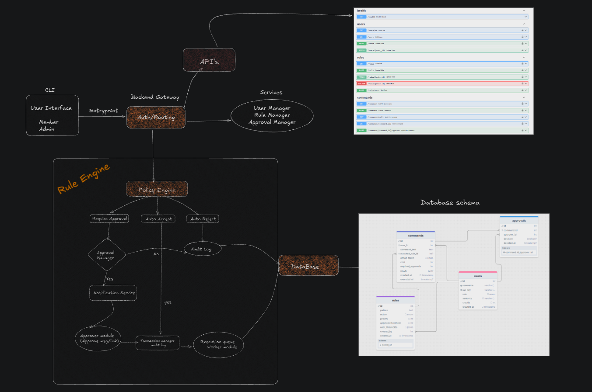
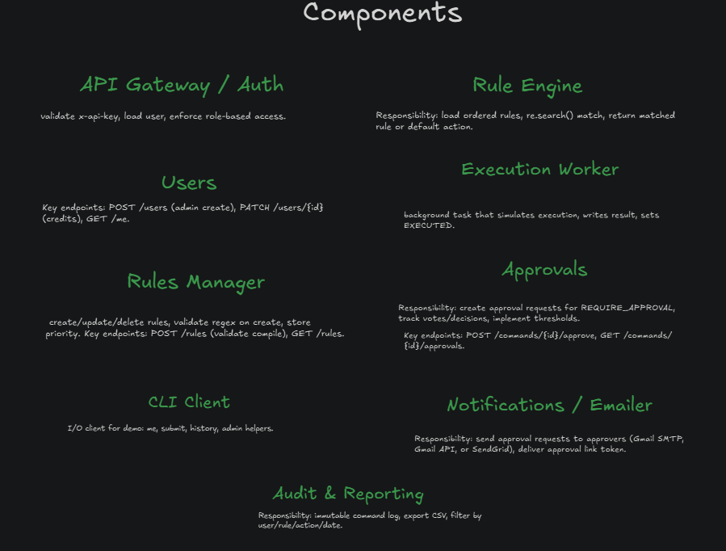
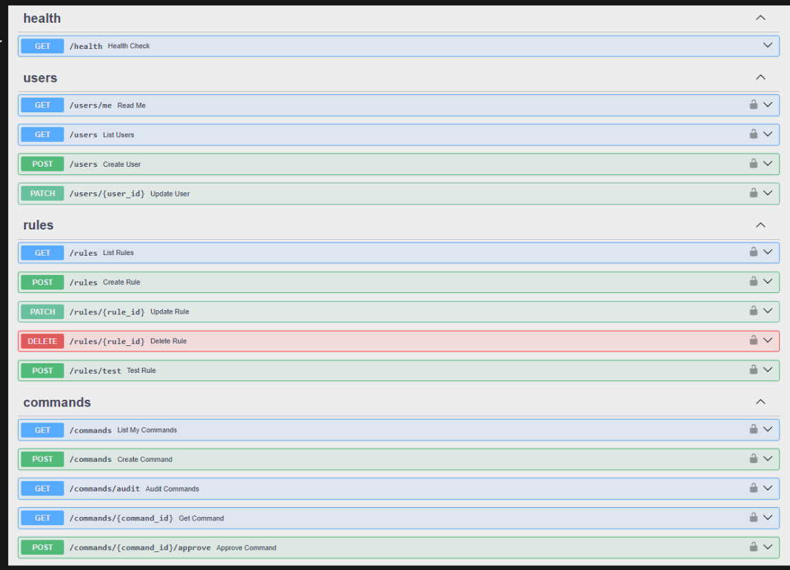
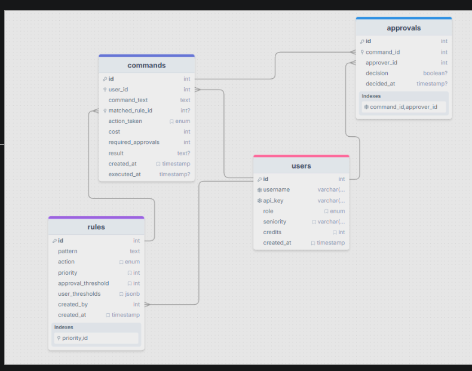
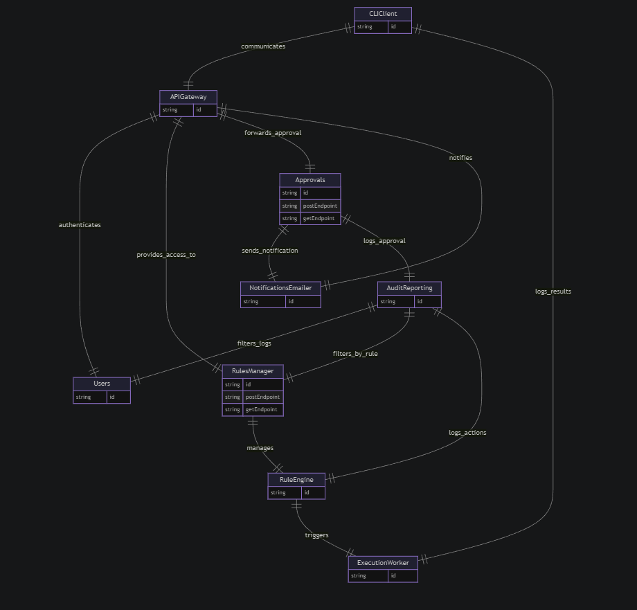

# Unbound Hackathon: Command Gateway

FastAPI + SQLModel gateway that inspects every command with ordered regex rules, enforces credits, and routes actions to auto-accept, auto-reject, or approval. Execution is always mocked for safety. SQLite by default

## Diagrams
Existing visuals live in `docs/`:
- Architecture: 
- Components: 
- API surface: 
- Data model: 
- Workflow: 

## Highlights
- Validated regex rule engine (rejects invalid/slow patterns before saving)
- Actions: `AUTO_ACCEPT`, `AUTO_REJECT`, `REQUIRE_APPROVAL`
- Approval thresholds per rule plus per-seniority overrides (`junior`, `standard`, `senior`, `lead`)
- Credits deducted only on accepts; async SQLModel transactions prevent negative balances
- Notifications: Telegram and SMTP (Gmail-friendly via App Password)
- CLI for users/rules/approvals/audit and a seeding script for 15 starter rules
- Mock executor; no real shell commands ever run

## How It Works
1. Client sends command with `x-api-key`.
2. Rules ordered by `priority ASC, id ASC`; invalid regex is rejected on create.
3. Action = matched rule action, else `DEFAULT_RULE_ACTION`.
4. `REQUIRE_APPROVAL` stores `WAITING_APPROVAL`, sets `required_approvals` (rule threshold or per-seniority override), notifies admins, and auto-transitions to `PENDING` once votes meet the threshold.
5. `AUTO_ACCEPT` deducts credits and schedules mock execution; `AUTO_REJECT` records rejection.
6. Worker marks `EXECUTED` and stores result "mock: would run: <cmd>".

## Data Model (SQLModel)
- users: username (unique), api_key (unique), role (admin/member), seniority (junior/standard/senior/lead), credits, timestamps
- rules: pattern, action, priority, approval_threshold, user_thresholds (JSON), created_by, timestamps
- commands: user_id, command_text, matched_rule_id, action_taken, cost, required_approvals, result, tx_id, timestamps
- approvals: command_id, approver_id, decision, decided_at (one per admin per command)
- Indexes on api_key, rule priority/id, command user/rule, approvals command

## API Surface
- Member: `GET /users/me`, `POST /commands`, `GET /commands`, `GET /commands/{id}`
- Admin: `POST /users`, `GET /users`, `PATCH /users/{id}`, `POST /rules`, `GET /rules`, `PATCH /rules/{id}`, `DELETE /rules/{id}`, `POST /rules/test`, `POST /commands/{id}/approve`, `GET /commands/audit`

## Environment
```
DATABASE_URL=sqlite+aiosqlite:///./gateway.db
DEFAULT_RULE_ACTION=AUTO_REJECT        # or REQUIRE_APPROVAL
DEFAULT_APPROVAL_THRESHOLD=1
DEFAULT_COMMAND_COST=1
DEFAULT_CREDITS=100
RATE_LIMIT_PER_MINUTE=60
# Telegram (optional)
TELEGRAM_BOT_TOKEN=
TELEGRAM_CHAT_ID=
# Email (optional; Gmail example)
EMAIL_SMTP_HOST=smtp.gmail.com
EMAIL_SMTP_PORT=587
EMAIL_FROM=you@gmail.com
EMAIL_TO=you@gmail.com
EMAIL_USERNAME=you@gmail.com
EMAIL_PASSWORD=<Gmail App Password>
```
Restart the API after editing `.env`.

## Setup & Run
```sh
# clone
cd unbound_hackathon
./setup.sh                 # copies .env.example, creates .venv, installs deps
source .venv/bin/activate
uvicorn app.main:app --app-dir gateway/app --reload
```
Windows (PowerShell) equivalent:
```powershell
python -m venv .venv
.\.venv\Scripts\Activate.ps1
pip install -r gateway/requirements.txt
uvicorn app.main:app --app-dir gateway/app --reload
```

## CLI Usage (Typer)
```sh
# Create users
gateway-cli users create --username alice --role admin --credits 200
gateway-cli users create --username bob --role member --credits 100

# Rules
gateway-cli rules create            # prompts for pattern/action/priority
gateway-cli rules delete <rule_id>
gateway-cli rules list

# Submit command (member)
gateway-cli commands submit "ls -la"

# Approvals (admin)
gateway-cli approvals pending
gateway-cli approvals approve <command_id>
gateway-cli approvals reject <command_id>

# Audit
gateway-cli audit --rule-id 1
```

## Seed 15 Rules
```sh
# Using env
GATEWAY_API_KEY=<ADMIN_KEY> python gateway/scripts/seed_rules.py
# Or flags
python gateway/scripts/seed_rules.py --api-key <ADMIN_KEY> --base-url http://localhost:8000
```

## Notifications
- Telegram: set `TELEGRAM_BOT_TOKEN`, `TELEGRAM_CHAT_ID`.
- Gmail SMTP: enable 2FA, create an App Password, set email vars above. Emails send when a command enters `WAITING_APPROVAL`.

## Testing
```sh
pip install -e .[dev]
pytest gateway/tests
```

## Repository Layout
```
gateway/
  app/          # api, core, db models, worker
  cli/          # typer CLI
  scripts/      # seed_rules.py
  tests/        # pytest suite

  arch.png
  api.png
  comps.png
  schema.png
  workflow.png
README.md
```
